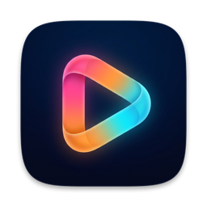
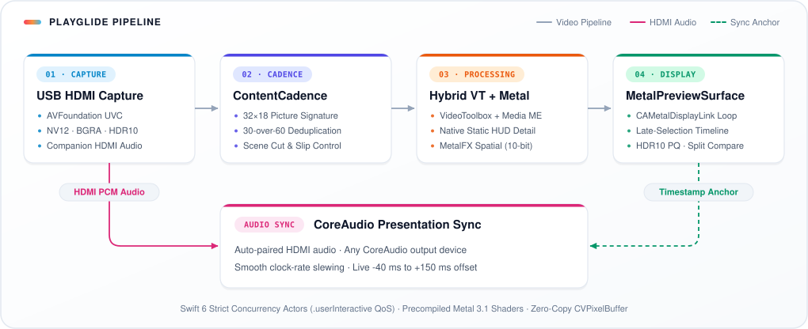

<div align="center">



# PlayGlide

**Turn your Apple silicon Mac into a low-latency, 2× frame-interpolated display for consoles and HDMI devices.**

[English](README.md) · [简体中文](docs/README.zh-CN.md) · [日本語](docs/README.ja.md) · [한국어](docs/README.ko.md)

[](https://github.com/eliosxie/PlayGlide/releases) [](#requirements) [](#build-from-source) [](LICENSE)

[Features](#features) · [Quick Start](#quick-start) · [Shortcuts](#keyboard-shortcuts) · [Architecture](#architecture) · [Build from Source](#build-from-source) · [FAQ](#faq)

</div>

---

**PlayGlide** is a native macOS app built with Swift 6, VideoToolbox, MetalFX, and Metal that turns your Mac into a responsive display for your **PlayStation, Xbox, Nintendo Switch**, or any other unencrypted HDMI source through a USB HDMI capture card.

Play in a window, expanded viewport, or unobstructed fullscreen with **2× real-time frame interpolation (30 → 60 fps)**, **HDR10 (BT.2020 PQ)** preview, **MetalFX Spatial** upscaling, and **presentation-synced HDMI audio**.

---

## Features

<table>
  <tr>
    <td width="50%" valign="top">
      <h3>Real-Time 2× Frame Interpolation</h3>
      <p>Turns 30 fps console gameplay into a smooth 60 fps preview. Even when a capture card delivers 30 fps games inside a 60 Hz or 59.94 Hz signal, PlayGlide detects repeated frames, compensates for USB burst slips, and passes native 60 fps menus or gameplay straight through automatically.</p>
    </td>
    <td width="50%" valign="top">
      <h3>Hybrid 1440p / 4K Pipeline</h3>
      <p>Keeps original frames at full native resolution while pairing VideoToolbox low-latency interpolation with concurrent media-engine motion estimation. Static HUDs and crisp UI text stay native and flicker-free, with HUD dehalo protection and confidence-modulated CAS sharpening.</p>
    </td>
  </tr>
  <tr>
    <td width="50%" valign="top">
      <h3>HDR10 (BT.2020 PQ) &amp; MetalFX Spatial</h3>
      <p>Supports SDR (Rec.709), HDR10 (BT.2020 PQ), and automatic SDR/HDR signal detection with two tone styles (<strong>Enhanced Contrast</strong> and <strong>Reference BT.2100 PQ</strong>), optional 8-bit UVC debanding, automatic display HDR switching, and 10-bit <strong>MetalFX Spatial</strong> upscaling up to 4K.</p>
    </td>
    <td width="50%" valign="top">
      <h3>Presentation-Synced HDMI Audio</h3>
      <p>Automatically pairs your capture card's companion USB HDMI audio (never hijacking your built-in microphone), routes to any CoreAudio output device, and anchors playback to actual frame presentation times with smooth clock slewing and live <code>-40 ms</code> to <code>+150 ms</code> offset control.</p>
    </td>
  </tr>
  <tr>
    <td width="50%" valign="top">
      <h3>Low-Latency Direct Metal Display</h3>
      <p>Renders directly to <code>CAMetalLayer</code> via <code>CAMetalDisplayLink</code> using precompiled Metal shaders and late-selection scheduling on high-refresh displays (e.g., 120 Hz ProMotion). Fullscreen mode hides UI chrome and cursor after inactivity to preserve Direct-to-Display scanout.</p>
    </td>
    <td width="50%" valign="top">
      <h3>Live Switching &amp; Split Comparison</h3>
      <p>Toggle <strong>Compare with Original</strong> for an instant side-by-side split view, switch interpolation quality (<strong>1080p High Detail</strong> / <strong>720p Low Latency</strong> / <strong>Off</strong>) or upscaling live without dropping capture or audio, and monitor real-time FPS and p50/p95 in-app latency.</p>
    </td>
  </tr>
</table>

---

## Requirements

| Requirement | Details |
| :--- | :--- |
| **Mac** | Apple silicon Mac (`arm64`) — developed and tested on M3 Max |
| **OS** | macOS 27 or later |
| **Capture Card** | Any USB HDMI capture card (UVC) recognized by macOS |
| **HDMI Signal** | Unencrypted HDMI output (HDCP disabled on the console/source) |
| **HDR10 (Optional)** | HDR source signal, capture card with HDR passthrough (hardware tone mapping off), and an HDR-capable display |

---

## Quick Start

### 1. Download and Install

1. Download the latest `PlayGlide-v*-macOS-arm64.dmg` (or `.zip`) from [**GitHub Releases**](https://github.com/eliosxie/PlayGlide/releases).
2. *(Optional)* Verify the download integrity using the accompanying `SHA256SUMS.txt`:
   ```bash
   shasum -a 256 -c SHA256SUMS.txt
   ```
3. Open the DMG and drag **PlayGlide.app** into **Applications**.

> [!NOTE]
> Release builds are currently ad-hoc signed with Hardened Runtime and are not yet notarized by Apple, so macOS Gatekeeper may block the first launch. Follow [Apple's guide to opening an app from an unidentified developer](https://support.apple.com/en-us/102445) to allow it once in **System Settings → Privacy & Security**.

### 2. Connect Your Hardware

1. Disable **HDCP** on your console if applicable (for example, on PlayStation: *Settings → System → HDMI → Enable HDCP → Off*).
2. Connect the console's **HDMI Out** to the capture card's **HDMI In**.
3. Plug the capture card into your Mac over **USB** (use a USB 3.0 / 5 Gbps+ port and cable for uncompressed 1080p60 or 4K capture).

### 3. Start Playing

1. Launch **PlayGlide**, pick your capture card and desired **Capture Format**, and click **Start Capture** (`⌘ Return`).
2. Grant **Camera** permission when prompted so macOS allows video capture from the UVC device.
3. For game audio, enable **Play and Sync Capture Audio** and grant **Microphone** permission so PlayGlide can read the capture card's companion HDMI audio stream.

> [!TIP]
> You can switch the UI language between **English** and **简体中文** at any time from the menu bar (**Language / 语言**) without restarting capture.

---

## Picture, Motion & Sound Controls

| Area | Options |
| :--- | :--- |
| **Content Cadence** | **Detect Repeated Frames** (auto-deduplicates 30-over-60 / 29.97-over-59.94 and passes native 60 fps through) or **Keep All Input Frames** |
| **Interpolation** | **Off (Original Cadence)** or **2× (30 → 60)** with **High Detail (1080p Engine)** and **Low Latency (720p Engine)** tiers |
| **Presentation Mode** | **Low Latency** (runs at maximum display refresh rate with 1-frame buffer) or **Steady Playback** (matches output cadence with an extra buffer frame) |
| **Color & HDR10** | **SDR · Rec.709**, **HDR10 · BT.2020 PQ**, or **Auto (SDR / HDR10)**; **Enhanced Contrast** or **Reference (BT.2100 PQ)** tone style; display HDR automation (**Fullscreen**, **During Capture**, or **Manual**) |
| **Upscaling** | **Off (Source Resolution)** or **MetalFX Spatial** (`2×`, `2560 × 1440`, or `3840 × 2160` up to 4K) |
| **Capture Audio** | Companion HDMI input auto-match, selectable CoreAudio output device, volume & mute, and live **Audio Sync Offset** (`-40 ms` to `+150 ms`) |
| **Live Telemetry** | Capture FPS, Content FPS & detected repeats, Presented / Generated FPS (5 s avg), Processing p95, Display Hz / GPU ms, and In-App Latency p50 / p95 |

---

## Keyboard Shortcuts

| Shortcut | Action |
| :--- | :--- |
| `⌘ Return` | Start / Stop capture |
| `⌃ ⌘ F` | Enter / Exit fullscreen |
| `⇧ ⌘ M` or Double-click | Expand preview inside window / Restore workspace (`Esc` to restore) |
| `⌥ ⌘ M` | Mute / Unmute capture audio |
| `⌘ 0` | Switch live to **Passthrough · Interpolation Off** |
| `⌘ 1` | Switch live to **2× High Detail (1080p Engine)** |
| `⌘ 2` | Switch live to **2× Low Latency (720p Engine)** |
| `⌥ ⌘ S` | Show / Hide minimal fullscreen FPS & latency HUD |

---

## Architecture

PlayGlide is built around a strict-concurrency **Swift 6** actor pipeline (`PlayGlide.pipeline.session` and `PlayGlide.frame.processor` running at `.userInteractive` QoS) paired with custom **Metal 3.1** compute and render shaders.

<p align="center">
  <picture>
    <source media="(prefers-color-scheme: dark)" srcset="docs/assets/architecture-dark.svg" />
    <source media="(prefers-color-scheme: light)" srcset="docs/assets/architecture-light.svg" />
    
  </picture>
</p>

### Project Layout

```text
PlayGlide/
├── project.yml                         # XcodeGen specification (Swift 6, macOS 27, arm64)
├── PlayGlide.xcodeproj/                # Ready-to-open Xcode project
├── config/
│   ├── Info.plist                      # App bundle metadata & camera/mic usage descriptions
│   └── PlayGlide.entitlements          # App Sandbox, camera & audio-input entitlements
├── scripts/
│   └── build-preview.sh                # Standalone Swift + Metal CLI preview builder
└── src/PlayGlide/
    ├── App/                            # Launcher (single-instance lock), menu commands, WorkspaceModel
    ├── Capture/                        # AVFoundation UVC + CoreAudio capture, dev test & window sources
    ├── Domain/                         # SessionDraft, ContentCadence, PresentationLatency, localization
    ├── Features/Workspace/             # SwiftUI workspace, live telemetry grid & SessionInspector
    ├── Pipeline/                       # PipelineSession orchestration & PerformanceHold state keeper
    ├── Presentation/                   # FrameMailbox, MetalPreviewSurface & CAMetalDisplayLink loop
    ├── Processing/                     # VideoProcessingStage, HybridInterpolator, FlowInterpolator, SpatialUpscaler
    └── Shaders/                        # HybridShaders.metal, PreviewShaders.metal, FlowShaders.metal
```

---

## Build from Source

### Prerequisites

- **Apple silicon Mac** running **macOS 27** or later
- **Xcode 27** or later with the **macOS 27 SDK** (and Metal Toolchain for precompiling `default.metallib`)

### Build with Xcode

1. Clone the repository:
   ```bash
   git clone https://github.com/eliosxie/PlayGlide.git
   cd PlayGlide
   ```
2. Open [PlayGlide.xcodeproj](PlayGlide.xcodeproj) in Xcode.
3. Select the **PlayGlide** scheme and press **`⌘ R`**.

> [!NOTE]
> `PlayGlide.xcodeproj` is generated from [project.yml](project.yml) (XcodeGen ≥ 2.46.0). If you add or reorganize source files, run `xcodegen generate` to refresh the Xcode project.

### Build from the Command Line

You can also compile a local `.app` bundle directly with the Swift toolchain (no Xcode IDE required):

```bash
# Standard local preview build -> .build/preview/PlayGlide.app
./scripts/build-preview.sh

# Development build with diagnostic tools -> .build/development/PlayGlide.app
./scripts/build-preview.sh --development
```

Passing `--development` defines `PLAYGLIDE_DEVELOPMENT`, which unlocks developer-oriented tools in the UI:
- **Built-In Synthetic Test Patterns** (30-over-60, 29.97-over-59.94, hitches, dynamic 30↔60 cadence, scene cuts — testable without a capture card)
- **Experimental Window Capture** (via `ScreenCaptureKit`)
- **4× Interpolation (30 → 120)** and explicit backend selectors (**VideoToolbox Low Latency**, **VideoToolbox Native FRC**, **Vision Optical Flow**)
- **Performance and Latency Details** diagnostics sheet

---

## FAQ

<details>
<summary><strong>macOS says PlayGlide cannot be opened or is from an unidentified developer</strong></summary>

Release builds currently use an ad-hoc signature and are not notarized by Apple. Open **System Settings → Privacy & Security**, scroll down to the Security section, and click **Open Anyway**, or follow [Apple's instructions](https://support.apple.com/en-us/102445).

</details>

<details>
<summary><strong>I get a black screen or "waiting for input" when connecting my console</strong></summary>

1. Verify that **HDCP** is turned off in your console's HDMI settings — PlayGlide can only capture unencrypted HDMI signals.
2. Confirm the capture card is connected to a sufficiently fast USB port (USB 3.0 / 5 Gbps+ recommended) and try clicking **Refresh Devices and Formats**.
3. If your console just switched resolution or SDR/HDR mode, allow a moment for HDMI handshake re-negotiation.

</details>

<details>
<summary><strong>HDR10 looks washed out or clips highlights</strong></summary>

1. Disable any **hardware HDR-to-SDR tone mapping** in your capture card's own utility so raw BT.2020 PQ reaches macOS.
2. Select **HDR10 · BT.2020 PQ** (or **Auto**) in PlayGlide's **Color Mode**, and make sure your Mac display has HDR enabled (or leave **Display HDR** set to *Enable in Fullscreen*).
3. Switch between **Enhanced Contrast** and **Reference (BT.2100 PQ)** under **HDR Tone Style** to match your preference.

</details>

<details>
<summary><strong>How do I fix slight audio lag or early sound?</strong></summary>

Enable **Play and Sync Capture Audio**, confirm the **Audio Output** device, and adjust the **Audio Sync Offset** slider (`-40 ms` to `+150 ms`). Positive values delay audio (useful for higher-latency external displays/TVs); negative values advance audio. Changes apply immediately without restarting capture.

</details>

---

## Contributing

Bug reports, capture-card compatibility notes, and pull requests are welcome!
- Open an [Issue](https://github.com/eliosxie/PlayGlide/issues) with your Mac model, macOS version, capture card model, and input format when reporting bugs.
- Before opening a PR, please ensure the app builds cleanly with Swift 6 strict concurrency enabled (`.github/workflows/macos.yml` runs on pull requests) and matches `.swift-format` / `.editorconfig`.

## License

PlayGlide is free software licensed under the **[GNU General Public License v3.0](LICENSE)**.
