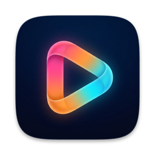
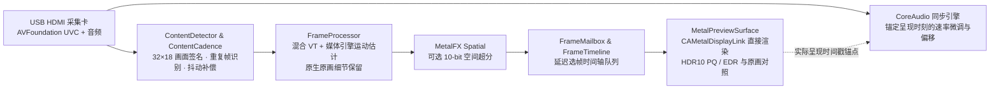

<div align="center">



# PlayGlide

**将搭载 Apple 芯片的 Mac 变为低延迟、支持 2× 实时补帧的主机与 HDMI 显示器。**

[English](README.md) · [简体中文](README.zh-CN.md)

[](https://github.com/eliosxie/PlayGlide/releases) [](#系统要求) [](#从源码构建) [](LICENSE)

[核心特性](#核心特性) · [快速开始](#快速开始) · [快捷键](#快捷键) · [技术架构](#技术架构) · [从源码构建](#从源码构建) · [常见问题](#常见问题)

</div>

---

**PlayGlide** 是一款基于 Swift 6、VideoToolbox、MetalFX 与 Metal 打造的原生 macOS 应用。只需一张 USB HDMI 采集卡，即可把 Mac 当作 **PlayStation、Xbox、Nintendo Switch** 或其他未加密 HDMI 设备的低延迟显示器。

支持窗口、窗口内最大化与无遮挡全屏游玩，提供 **2× 实时补帧（30 → 60 fps）**、**HDR10（BT.2020 PQ）** 预览、**MetalFX Spatial** 超分放大，以及**锚定画面呈现时刻的音画同步播放**。

---

## 核心特性

<table>
  <tr>
    <td width="50%" valign="top">
      <h3>2× 实时补帧与智能去重</h3>
      <p>将 30 帧主机游戏以丝滑的 60 帧实时呈现。即使采集卡以 60 Hz / 59.94 Hz 信号封装 30 帧画面，PlayGlide 也能识别其中的重复帧、补偿 USB 突发传输抖动，并在切回原生 60 帧菜单或实机画面时自动无感直通。</p>
    </td>
    <td width="50%" valign="top">
      <h3>1440p / 4K 混合补帧管线</h3>
      <p>原始帧保持完整原生分辨率，中间帧结合 VideoToolbox 低延迟插值与并行媒体引擎运动估计生成。静止 HUD 与锐利文字保留原生像素、拒绝闪烁，并内置 HUD 去晕影保护与置信度自适应 CAS 锐化。</p>
    </td>
  </tr>
  <tr>
    <td width="50%" valign="top">
      <h3>HDR10（BT.2020 PQ）与 MetalFX 超分</h3>
      <p>支持 SDR（Rec.709）、HDR10（BT.2020 PQ）及自动信号识别，提供<strong>增强对比</strong>与<strong>精准参考（BT.2100 PQ）</strong>两种 HDR 风格、8-bit UVC 去色带优化、显示器 HDR 自动切换，以及最高 4K 的 10-bit <strong>MetalFX Spatial</strong> 画面放大。</p>
    </td>
    <td width="50%" valign="top">
      <h3>呈现时刻锚定的音画同步</h3>
      <p>自动匹配采集卡伴生 USB HDMI 音频（绝不误选内建麦克风），支持任意 CoreAudio 输出设备，以处理后画面的实际显示时刻作为时间锚点，平滑微调音频速率并支持 <code>-40 ms</code> 至 <code>+150 ms</code> 实时手动偏移。</p>
    </td>
  </tr>
  <tr>
    <td width="50%" valign="top">
      <h3>Direct Metal 低延迟呈现</h3>
      <p>基于预编译 Metal 着色器与 <code>CAMetalDisplayLink</code> 直接渲染至 <code>CAMetalLayer</code>，在 120 Hz ProMotion 等高刷屏上启用延迟选帧调度。全屏静止后自动隐藏控件与光标，保持 Direct-to-Display 零合成扫描输出。</p>
    </td>
    <td width="50%" valign="top">
      <h3>免断流热切换与原画对照</h3>
      <p>一键开启<strong>原画对照</strong>左右分屏对比效果；实时切换补帧档位（<strong>1080p 高清细节</strong> / <strong>720p 极速低延迟</strong> / <strong>关闭直通</strong>）或超分设置而无需中断画面与声音，并在工作区查看实时帧率与应用内 p50/p95 延迟。</p>
    </td>
  </tr>
</table>

---

## 系统要求

| 项目 | 要求 |
| :--- | :--- |
| **Mac 机型** | 搭载 Apple 芯片的 Mac（`arm64`）—— 开发与实测环境为 M3 Max |
| **操作系统** | macOS 27 或更高版本 |
| **采集卡** | 任意 macOS 原生识别的 USB HDMI 采集卡（UVC） |
| **HDMI 信号** | 未受 HDCP 保护的 HDMI 输出（请在主机设置中关闭 HDCP） |
| **HDR10（可选）** | HDR 信号源、支持 HDR 直通（关闭硬件色调映射）的采集卡及支持 HDR 的显示器 |

---

## 快速开始

### 1. 下载与安装

1. 前往 [**GitHub Releases**](https://github.com/eliosxie/PlayGlide/releases) 下载最新的 `PlayGlide-v*-macOS-arm64.dmg`（或 `.zip`）。
2. *（可选）* 使用同目录的 `SHA256SUMS.txt` 校验文件完整性：
   ```bash
   shasum -a 256 -c SHA256SUMS.txt
   ```
3. 双击打开 DMG，将 **PlayGlide.app** 拖入 **Applications（应用程序）** 文件夹。

> [!NOTE]
> 当前发布版本使用临时签名（Ad-hoc）与强化运行时构建，尚未经过 Apple 公证，首次启动时可能会被 macOS Gatekeeper 拦截。请参考 [Apple 关于打开下载应用的说明](https://support.apple.com/zh-cn/102445)，在 **系统设置 → 隐私与安全性** 中允许打开一次即可。

### 2. 连接硬件

1. 在游戏主机设置中关闭 **HDCP**（例如 PlayStation：*设定 → 系统 → HDMI → 启用 HDCP → 关闭*）。
2. 使用 HDMI 线将主机的 **HDMI 输出** 连接到采集卡的 **HDMI 输入**。
3. 使用 USB 线将采集卡连接到 Mac（建议连接 USB 3.0 / 5 Gbps 及以上接口与线材，以获得无压缩 1080p60 或 4K 采集）。

### 3. 开始游玩

1. 打开 **PlayGlide**，选择采集卡与 **实际格式**，点击 **开始采集**（`⌘ Return`）。
2. 按系统提示授予 **相机** 权限，以便读取 UVC 采集卡视频流。
3. 若需通过 Mac 播放游戏声音，请开启 **播放采集卡音频并同步视频** 并授予 **麦克风** 权限，以读取采集卡伴生 HDMI 音频。

> [!TIP]
> 可随时通过顶部菜单栏 **Language / 语言** 在 **简体中文** 与 **English** 之间实时切换，无需重启采集会话。

---

## 画面、补帧与声音控制

| 模块 | 支持能力 |
| :--- | :--- |
| **内容节奏** | **识别重复内容**（自动去重 30-over-60 / 29.97-over-59.94，原生 60 帧自动直通）或 **保留全部传输帧** |
| **补帧模式** | **关闭（原始节奏）** 或 **2×（30 → 60）**，提供 **高清细节（1080p 引擎）** 与 **极速低延迟（720p 引擎）** 档位 |
| **呈现策略** | **低延迟**（以显示器最高刷新率驱动，1 帧缓冲）或 **平稳优先**（按输出节奏刷新，多缓冲 1 帧吸收抖动） |
| **色彩与 HDR10** | **SDR · Rec.709**、**HDR10 · BT.2020 PQ** 与 **自动识别**；支持 **增强对比** / **精准参考（BT.2100 PQ）** 风格，以及 **全屏开启 / 采集时开启 / 手动** 显示器 HDR 策略 |
| **画面放大** | **关闭（保留原尺寸）** 或 **MetalFX Spatial**（`宽高各 2×`、`2560 × 1440` 或 `3840 × 2160`，上限 4K） |
| **采集音频** | 自动匹配采集卡 HDMI 音频输入、可选任意 CoreAudio 输出设备、音量/静音及 `-40 ms` ～ `+150 ms` 实时 **音画手动偏移** |
| **实时监控** | 采集传输帧率、内容输入帧率与重复帧计数、实际呈现 / 生成速率（5 秒均值）、处理 p95、显示刷新率 / GPU 耗时、应用内延迟 p50 / p95 |

---

## 快捷键

| 快捷键 | 功能 |
| :--- | :--- |
| `⌘ Return` | 开始 / 停止采集 |
| `⌃ ⌘ F` | 进入 / 退出全屏 |
| `⇧ ⌘ M` 或双击画面 | 画面窗口内最大化 / 恢复工作区（`Esc` 可恢复） |
| `⌥ ⌘ M` | 静音 / 取消静音采集卡音频 |
| `⌘ 0` | 实时切换：**直通 · 关闭补帧** |
| `⌘ 1` | 实时切换：**2× 高清补帧（1080p 引擎）** |
| `⌘ 2` | 实时切换：**2× 极速补帧（720p 引擎）** |
| `⌥ ⌘ S` | 显示 / 隐藏全屏精简帧率与延迟 HUD |

---

## 技术架构

PlayGlide 采用启用完整严格并发检查的 **Swift 6** Actor 管线（`PlayGlide.pipeline.session` 与 `PlayGlide.frame.processor` 运行于 `.userInteractive` 队列），结合自定义 **Metal 3.1** 计算与渲染着色器构建。



### 目录结构

```text
PlayGlide/
├── project.yml                         # XcodeGen 工程配置（Swift 6, macOS 27, arm64）
├── PlayGlide.xcodeproj/                # 可直接打开的 Xcode 工程
├── config/
│   ├── Info.plist                      # 应用元信息与相机/麦克风权限说明
│   └── PlayGlide.entitlements          # App Sandbox、相机与音频输入权限配置
├── scripts/
│   └── build-preview.sh                # 命令行 Swift + Metal 本地预览构建脚本
└── src/PlayGlide/
    ├── App/                            # 单实例启动锁、菜单快捷键与 WorkspaceModel
    ├── Capture/                        # AVFoundation UVC 与 CoreAudio 采集、开发测试源与窗口采集
    ├── Domain/                         # SessionDraft、ContentCadence、PresentationLatency 与双语文案
    ├── Features/Workspace/             # SwiftUI 主工作区、实时性能网格与 SessionInspector
    ├── Pipeline/                       # PipelineSession 编排与 PerformanceHold 性能保持线程
    ├── Presentation/                   # FrameMailbox、MetalPreviewSurface 与 CAMetalDisplayLink 渲染循环
    ├── Processing/                     # VideoProcessingStage、HybridInterpolator、FlowInterpolator、SpatialUpscaler
    └── Shaders/                        # HybridShaders.metal、PreviewShaders.metal、FlowShaders.metal
```

---

## 从源码构建

### 环境准备

- 搭载 **Apple 芯片**、运行 **macOS 27** 或更高版本的 Mac
- **Xcode 27** 或更高版本及 **macOS 27 SDK**（安装 Metal Toolchain 可预编译 `default.metallib`）

### 使用 Xcode 运行

1. 克隆仓库：
   ```bash
   git clone https://github.com/eliosxie/PlayGlide.git
   cd PlayGlide
   ```
2. 在 Xcode 中打开 [PlayGlide.xcodeproj](PlayGlide.xcodeproj)。
3. 选择 **PlayGlide** 方案，按 **`⌘ R`** 编译运行。

> [!NOTE]
> `PlayGlide.xcodeproj` 由 [project.yml](project.yml) 生成（XcodeGen ≥ 2.46.0）。若新增或调整源码目录，请运行 `xcodegen generate` 同步更新工程文件。

### 使用命令行构建

也可以直接通过 Swift 工具链在本地编译 `.app` 包，无需打开 Xcode IDE：

```bash
# 标准本地预览构建 -> .build/preview/PlayGlide.app
./scripts/build-preview.sh

# 启用开发与诊断工具的构建 -> .build/development/PlayGlide.app
./scripts/build-preview.sh --development
```

添加 `--development` 会开启 `PLAYGLIDE_DEVELOPMENT` 编译标记，在界面中解锁开发与评测工具：
- **内置动态测试源**（支持 30-over-60、29.97-over-59.94、掉帧、30↔60 动态切换、定期切场等模式，无需采集卡即可体验）
- **网页 / 窗口采集（实验）**（基于 `ScreenCaptureKit`）
- **4× 补帧（30 → 120）** 及手动切换底层处理后端（**VT 低延迟** / **VT 原尺寸 FRC** / **Vision 光流重建**）
- **性能与延迟详情** 诊断面板

---

## 常见问题

<details>
<summary><strong>macOS 提示“无法打开”或“来自未识别的开发者”</strong></summary>

当前发布版本使用临时签名，尚未经过 Apple 公证。请前往 **系统设置 → 隐私与安全性**，在“安全性”区域点击 **仍要打开**，或查阅 [Apple 官方说明](https://support.apple.com/zh-cn/102445)。

</details>

<details>
<summary><strong>连接游戏主机后黑屏或一直提示“等待输入信号”</strong></summary>

1. 请确认主机已关闭 **HDCP** —— PlayGlide 仅支持采集未受 HDCP 加密保护的 HDMI 信号。
2. 确认采集卡接入了带宽充足的 USB 接口（推荐 USB 3.0 / 5 Gbps 及以上），并尝试点击 **刷新设备与格式**。
3. 若主机刚刚切换分辨率或 SDR / HDR 模式，请稍候片刻等待 HDMI 重新握手。

</details>

<details>
<summary><strong>HDR10 画面发灰或高光过曝</strong></summary>

1. 请在采集卡配套软件中关闭 **硬件 HDR 转 SDR 色调映射**，确保原始 BT.2020 PQ 信号直通至 Mac。
2. 在 PlayGlide 的 **色彩模式** 中选择 **HDR10 · BT.2020 PQ**（或 **自动识别**），并确保显示器已开启 HDR（或将 **显示器 HDR** 设为 *全屏时自动开启*）。
3. 可在 **HDR 画面风格** 中按观感偏好切换 **增强对比** 与 **精准参考（BT.2100 PQ）**。

</details>

<details>
<summary><strong>如何微调游戏声音略快或略慢的问题？</strong></summary>

勾选 **播放采集卡音频并同步视频** 并确认 **音频输出** 设备后，拖动 **音画手动偏移** 滑块（范围 `-40 ms` 至 `+150 ms`）。正值延后声音（适合高延迟外接显示器/电视），负值提前声音，调整实时生效无需重启采集。

</details>

---

## 参与贡献

欢迎提交 Issue 反馈问题、分享不同采集卡的兼容性实测结果，或发起 Pull Request：
- 提交 [Issue](https://github.com/eliosxie/PlayGlide/issues) 时请附上 Mac 机型、macOS 版本、采集卡型号及采集格式。
- 提交 PR 前请确保代码在 Swift 6 严格并发模式下可正常通过构建（PR 会自动触发 `.github/workflows/macos.yml`），并遵循 `.swift-format` 与 `.editorconfig` 规范。

## 许可证

PlayGlide 是自由软件，基于 **[GNU 通用公共许可证第 3 版（GPL-3.0）](LICENSE)** 开源。
