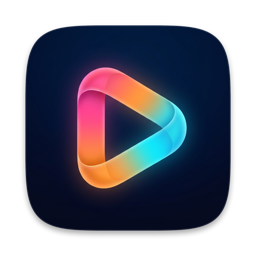
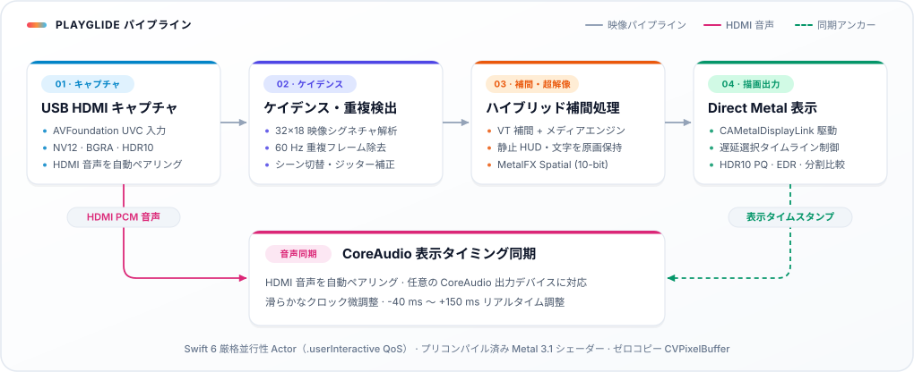

<div align="center">



# PlayGlide

**Apple シリコン搭載 Mac を、ゲーム機や HDMI デバイス向けの低遅延・2× リアルタイムフレーム補間ディスプレイに。**

[English](../README.md) · [简体中文](README.zh-CN.md) · [日本語](README.ja.md) · [한국어](README.ko.md)

[](https://github.com/eliosxie/PlayGlide/releases) [](#動作環境) [](#ソースからビルド) [](../LICENSE)

[主な機能](#主な機能) · [クイックスタート](#クイックスタート) · [ショートカット](#キーボードショートカット) · [アーキテクチャ](#アーキテクチャ) · [ソースからビルド](#ソースからビルド) · [よくある質問](#よくある質問)

</div>

---

**PlayGlide** は、Swift 6、VideoToolbox、MetalFX、Metal で構築されたネイティブ macOS アプリです。USB HDMI キャプチャカードを使うだけで、お使いの Mac を **PlayStation、Xbox、Nintendo Switch** やその他の暗号化されていない HDMI デバイス用の低遅延ディスプレイとして活用できます。

ウィンドウ表示、ウィンドウ内最大化、または邪魔な UI のないフルスクリーンでプレイでき、**2× リアルタイムフレーム補間（30 → 60 fps）**、**HDR10（BT.2020 PQ）** プレビュー、**MetalFX Spatial** アップスケーリング、そして**フレーム表示時刻に同期した HDMI 音声再生**を備えています。

---

## 主な機能

<table>
  <tr>
    <td width="50%" valign="top">
      <h3>リアルタイム 2× フレーム補間</h3>
      <p>30 fps のコンソールゲーム映像を滑らかな 60 fps プレビューへリアルタイム変換します。キャプチャカードが 60 Hz や 59.94 Hz の信号内に 30 fps の映像を載せて送ってくる場合でも、重複フレームを自動検出し、USB 転送ジッターを補正します。ネイティブ 60 fps のメニューやゲームプレイへ切り替わると自動でパススルーします。</p>
    </td>
    <td width="50%" valign="top">
      <h3>1440p / 4K ハイブリッド補間パイプライン</h3>
      <p>元フレームはネイティブ解像度のまま保持し、中間フレームは VideoToolbox 低遅延補間と並列メディアエンジン動き推定を組み合わせて生成します。静止 HUD やシャープな UI テキストは原画のままちらつきなく維持され、HUD デハロー保護と信頼度適応型 CAS シャープニングを備えます。</p>
    </td>
  </tr>
  <tr>
    <td width="50%" valign="top">
      <h3>HDR10（BT.2020 PQ）&amp; MetalFX Spatial</h3>
      <p>SDR（Rec.709）、HDR10（BT.2020 PQ）、SDR/HDR 自動信号検出に対応し、<strong>Enhanced Contrast</strong> と <strong>Reference（BT.2100 PQ）</strong> の 2 種類のトーンスタイル、8-bit UVC デバンディング、ディスプレイ HDR 自動切替、最大 4K の 10-bit <strong>MetalFX Spatial</strong> 超解像を提供します。</p>
    </td>
    <td width="50%" valign="top">
      <h3>表示タイミング同期 HDMI 音声</h3>
      <p>キャプチャカードに付属する USB HDMI 音声を自動ペアリングし（内蔵マイクを誤って使用しません）、任意の CoreAudio 出力デバイスへルーティングします。実際のフレーム表示時刻をアンカーとして滑らかにクロック微調整を行い、<code>-40 ms</code> ～ <code>+150 ms</code> のリアルタイム同期オフセット調整に対応します。</p>
    </td>
  </tr>
  <tr>
    <td width="50%" valign="top">
      <h3>低遅延 Direct Metal 表示</h3>
      <p>プリコンパイル済み Metal シェーダーと <code>CAMetalDisplayLink</code> により <code>CAMetalLayer</code> へ直接レンダリングし、120 Hz ProMotion などの高リフレッシュレート画面では遅延選択スケジューリングを活用します。フルスクリーン時に操作がない場合は UI とカーソルを自動で非表示にし、Direct-to-Display スキャンアウトを維持します。</p>
    </td>
    <td width="50%" valign="top">
      <h3>ライブ切替 &amp; 左右分割比較</h3>
      <p><strong>Compare with Original</strong> をオンにすれば左右分割で即座に原画比較が可能。キャプチャや音声を途切れさせずに補間品質（<strong>1080p High Detail</strong> / <strong>720p Low Latency</strong> / <strong>Off</strong>）や超解像をリアルタイムに切り替えられ、リアルタイム FPS やアプリ内 p50/p95 レイテンシも確認できます。</p>
    </td>
  </tr>
</table>

---

## 動作環境

| 項目 | 要件 |
| :--- | :--- |
| **Mac** | Apple シリコン搭載 Mac（`arm64`）— M3 Max にて開発・テスト済み |
| **OS** | macOS 27 以降 |
| **キャプチャカード** | macOS で認識される任意の USB HDMI キャプチャカード（UVC） |
| **HDMI 信号** | 非暗号化 HDMI 出力（ゲーム機／出力側で HDCP をオフにしてください） |
| **HDR10（任意）** | HDR 映像ソース、HDR パススルー対応（ハードウェアトーンマッピングオフ）のキャプチャカード、HDR 対応ディスプレイ |

---

## クイックスタート

### 1. ダウンロードとインストール

1. [**GitHub Releases**](https://github.com/eliosxie/PlayGlide/releases) から最新の `PlayGlide-v*-macOS-arm64.dmg`（または `.zip`）をダウンロードします。
2. *（任意）* 付属の `SHA256SUMS.txt` でファイルの整合性を検証できます：
   ```bash
   shasum -a 256 -c SHA256SUMS.txt
   ```
3. DMG を開き、**PlayGlide.app** を **Applications（アプリケーション）** フォルダへドラッグします。

> [!NOTE]
> 現在のリリースビルドは Hardened Runtime 付きのアドホック署名であり、Apple による公証（Notarization）は未取得のため、初回起動時に macOS Gatekeeper にブロックされる場合があります。[Apple の未確認の開発元のアプリを開くガイド](https://support.apple.com/ja-jp/102445) を参考に、**システム設定 → プライバシーとセキュリティ** から一度だけ起動を許可してください。

### 2. ハードウェアの接続

1. ゲーム機側で **HDCP** を無効にします（例：PlayStation の場合は *設定 → システム → HDMI → HDCPを有効にする → オフ*）。
2. ゲーム機の **HDMI 出力** をキャプチャカードの **HDMI 入力** に接続します。
3. キャプチャカードを **USB** で Mac に接続します（非圧縮の 1080p60 や 4K キャプチャには USB 3.0 / 5 Gbps 以上のポートとケーブルを使用してください）。

### 3. プレイを開始

1. **PlayGlide** を起動し、キャプチャカードと希望の **Capture Format** を選択して **Start Capture**（`⌘ Return`）をクリックします。
2. UVC デバイスからの映像キャプチャを許可するため、プロンプトが表示されたら **カメラ** 権限を許可します。
3. ゲーム音声を再生するには **Play and Sync Capture Audio** を有効にし、キャプチャカードの付属 HDMI 音声ストリームを読み取れるよう **マイク** 権限を許可します。

> [!TIP]
> アプリ内の UI 言語は、メニューバーの **Language / 语言** から **English** と **简体中文** をキャプチャを中断せずにいつでも切り替えられます。

---

## 映像・フレーム補間・音声コントロール

| カテゴリ | オプション |
| :--- | :--- |
| **コンテンツケイデンス** | **Detect Repeated Frames**（30-over-60 / 29.97-over-59.94 を自動重複除去し、ネイティブ 60 fps はパススルー）または **Keep All Input Frames** |
| **フレーム補間** | **Off (Original Cadence)** または **2× (30 → 60)**（**High Detail (1080p Engine)** / **Low Latency (720p Engine)** の 2 段階） |
| **表示モード** | **Low Latency**（ディスプレイ最大リフレッシュレートで駆動、1 フレームバッファ）または **Steady Playback**（出力ケイデンスに合わせて 1 フレーム多くバッファリング） |
| **カラー &amp; HDR10** | **SDR · Rec.709**、**HDR10 · BT.2020 PQ**、または **Auto (SDR / HDR10)**；トーンスタイルは **Enhanced Contrast** / **Reference (BT.2100 PQ)**；ディスプレイ HDR 自動制御（**Fullscreen** / **During Capture** / **Manual**） |
| **アップスケーリング** | **Off (Source Resolution)** または **MetalFX Spatial**（`2×`、`2560 × 1440`、`3840 × 2160`、最大 4K） |
| **キャプチャ音声** | 付属 HDMI 音声の自動マッチ、CoreAudio 出力デバイス選択、音量・ミュート、リアルタイム **Audio Sync Offset**（`-40 ms` ～ `+150 ms`） |
| **リアルタイム監視** | Capture FPS、Content FPS と検出重複フレーム、Presented / Generated FPS（5 秒平均）、Processing p95、Display Hz / GPU ms、アプリ内レイテンシ p50 / p95 |

---

## キーボードショートカット

| ショートカット | 動作 |
| :--- | :--- |
| `⌘ Return` | キャプチャの開始 / 停止 |
| `⌃ ⌘ F` | フルスクリーンの開始 / 終了 |
| `⇧ ⌘ M` またはダブルクリック | ウィンドウ内プレビュー最大化 / ワークスペース復帰（`Esc` でも復帰） |
| `⌥ ⌘ M` | キャプチャ音声のミュート / ミュート解除 |
| `⌘ 0` | ライブ切替：**Passthrough · Interpolation Off** |
| `⌘ 1` | ライブ切替：**2× High Detail (1080p Engine)** |
| `⌘ 2` | ライブ切替：**2× Low Latency (720p Engine)** |
| `⌥ ⌘ S` | フルスクリーン時の簡易 FPS・レイテンシ HUD の表示 / 非表示 |

---

## アーキテクチャ

PlayGlide は、厳格な並行性チェックを有効にした **Swift 6** Actor パイプライン（`.userInteractive` QoS で動作する `PlayGlide.pipeline.session` および `PlayGlide.frame.processor`）と、カスタム **Metal 3.1** コンピュート／レンダーシェーダーを中核として設計されています。

<p align="center">
  <picture>
    <source media="(prefers-color-scheme: dark)" srcset="assets/architecture-ja-dark.svg" />
    <source media="(prefers-color-scheme: light)" srcset="assets/architecture-ja-light.svg" />
    
  </picture>
</p>

### プロジェクト構成

```text
PlayGlide/
├── project.yml                         # XcodeGen 仕様ファイル（Swift 6, macOS 27, arm64）
├── PlayGlide.xcodeproj/                # そのまま開ける Xcode プロジェクト
├── config/
│   ├── Info.plist                      # アプリメタデータおよびカメラ／マイク使用説明
│   └── PlayGlide.entitlements          # App Sandbox、カメラ・音声入力エンタイトルメント
├── scripts/
│   └── build-preview.sh                # Swift + Metal CLI プレビュービルドスクリプト
└── src/PlayGlide/
    ├── App/                            # ランチャー（多重起動防止ロック）、メニューコマンド、WorkspaceModel
    ├── Capture/                        # AVFoundation UVC + CoreAudio キャプチャ、開発テスト・ウィンドウ入力ソース
    ├── Domain/                         # SessionDraft、ContentCadence、PresentationLatency、ローカライズ
    ├── Features/Workspace/             # SwiftUI ワークスペース、リアルタイムメトリクス表示、SessionInspector
    ├── Pipeline/                       # PipelineSession オーケストレーション、PerformanceHold 状態維持
    ├── Presentation/                   # FrameMailbox、MetalPreviewSurface、CAMetalDisplayLink ループ
    ├── Processing/                     # VideoProcessingStage、HybridInterpolator、FlowInterpolator、SpatialUpscaler
    └── Shaders/                        # HybridShaders.metal、PreviewShaders.metal、FlowShaders.metal
```

---

## ソースからビルド

### 前提条件

- **macOS 27** 以降を搭載した **Apple シリコン Mac**
- **macOS 27 SDK** を含む **Xcode 27** 以降（`default.metallib` のプリコンパイルには Metal Toolchain が必要）

### Xcode でビルド

1. リポジトリをクローンします：
   ```bash
   git clone https://github.com/eliosxie/PlayGlide.git
   cd PlayGlide
   ```
2. Xcode で [PlayGlide.xcodeproj](../PlayGlide.xcodeproj) を開きます。
3. **PlayGlide** スキームを選択し、**`⌘ R`** を押してビルド・実行します。

> [!NOTE]
> `PlayGlide.xcodeproj` は [project.yml](../project.yml) から生成されています（XcodeGen ≥ 2.46.0）。ソースファイルを追加または移動した場合は、`xcodegen generate` を実行してプロジェクトを更新してください。

### コマンドラインからビルド

Xcode IDE を開かずに Swift ツールチェーンから直接ローカル `.app` バンドルをビルドすることもできます：

```bash
# 標準のローカルプレビュービルド -> .build/preview/PlayGlide.app
./scripts/build-preview.sh

# 診断ツール付きの開発ビルド -> .build/development/PlayGlide.app
./scripts/build-preview.sh --development
```

`--development` を指定すると `PLAYGLIDE_DEVELOPMENT` が定義され、UI 内に開発者向けツールが解放されます：
- **内蔵合成テストパターン**（30-over-60、29.97-over-59.94、コマ落ち、30↔60 動的切替、シーンカットなど — キャプチャカードなしで検証可能）
- **実験的ウィンドウキャプチャ**（`ScreenCaptureKit` 経由）
- **4× 補間（30 → 120）** およびバックエンドの明示的選択（**VideoToolbox Low Latency**、**VideoToolbox Native FRC**、**Vision Optical Flow**）
- **パフォーマンスとレイテンシ詳細** 診断シート

---

## よくある質問

<details>
<summary><strong>macOS で「開けません」または「未確認の開発元」と表示される</strong></summary>

現在のリリースビルドはアドホック署名を使用しており、Apple による公証を受けていません。**システム設定 → プライバシーとセキュリティ** を開き、「セキュリティ」セクションまでスクロールして **このまま開く** をクリックするか、[Apple の公式手順](https://support.apple.com/ja-jp/102445) を参照してください。

</details>

<details>
<summary><strong>ゲーム機を接続しても画面が真っ暗、または「入力待機中」のままになる</strong></summary>

1. ゲーム機の HDMI 設定で **HDCP** がオフになっているか確認してください — PlayGlide は暗号化されていない HDMI 信号のみキャプチャできます。
2. キャプチャカードが十分な帯域のある USB ポート（USB 3.0 / 5 Gbps 以上推奨）に接続されていることを確認し、**Refresh Devices and Formats** をクリックしてみてください。
3. ゲーム機が解像度や SDR/HDR モードを切り替えた直後の場合は、HDMI ハンドシェイクの再ネゴシエーションが終わるまで数秒お待ちください。

</details>

<details>
<summary><strong>HDR10 の映像が白っぽい、またはハイライトが白飛びする</strong></summary>

1. キャプチャカード付属ユーティリティで **ハードウェア HDR→SDR トーンマッピング** をオフにし、生の BT.2020 PQ 信号が macOS に届くようにしてください。
2. PlayGlide の **Color Mode** で **HDR10 · BT.2020 PQ**（または **Auto**）を選択し、Mac のディスプレイで HDR が有効になっていること（または **Display HDR** が *Enable in Fullscreen* になっていること）を確認してください。
3. **HDR Tone Style** で **Enhanced Contrast** と **Reference (BT.2100 PQ)** を好みに合わせて切り替えてみてください。

</details>

<details>
<summary><strong>音声のわずかな遅延や先行を補正するには？</strong></summary>

**Play and Sync Capture Audio** を有効にし、**Audio Output** デバイスを確認したうえで、**Audio Sync Offset** スライダー（`-40 ms` ～ `+150 ms`）を調整してください。プラスの値で音声を遅らせ（遅延が大きい外部ディスプレイ／テレビ向け）、マイナスの値で音声を早めます。変更はキャプチャを再起動することなく即座に反映されます。

</details>

---

## コントリビューション

バグ報告、キャプチャカードの互換性レポート、プルリクエストを歓迎します！
- バグを報告する際は、Mac のモデル、macOS バージョン、キャプチャカードの型番、入力フォーマットを添えて [Issue](https://github.com/eliosxie/PlayGlide/issues) を作成してください。
- PR を作成する前に、Swift 6 厳格並行性チェックを有効にした状態で問題なくビルドできること（PR 時に `.github/workflows/macos.yml` が実行されます）、および `.swift-format` / `.editorconfig` に準拠していることを確認してください。

## ライセンス

PlayGlide は **[GNU 一般公衆利用許諾書 v3.0（GPL-3.0）](../LICENSE)** の下で公開されているフリーソフトウェアです。
