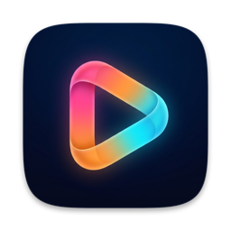
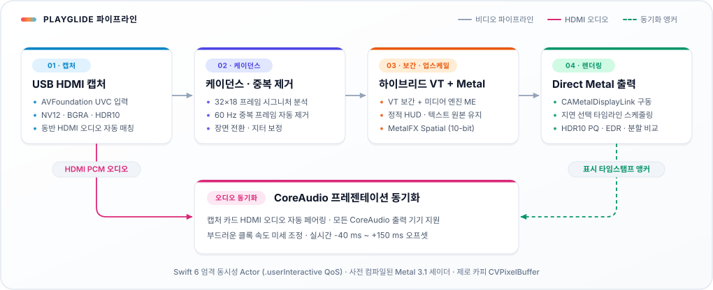

<div align="center">



# PlayGlide

**Apple Silicon Mac을 콘솔 및 HDMI 기기를 위한 저지연, 2× 실시간 프레임 보간 디스플레이로 전환하세요.**

[English](../README.md) · [简体中文](README.zh-CN.md) · [日本語](README.ja.md) · [한국어](README.ko.md)

[](https://github.com/eliosxie/PlayGlide/releases) [](#시스템-요구-사항) [](#소스에서-빌드) [](../LICENSE)

[주요 기능](#주요-기능) · [빠른 시작](#빠른-시작) · [단축키](#키보드-단축키) · [아키텍처](#아키텍처) · [소스에서 빌드](#소스에서-빌드) · [자주 묻는 질문](#자주-묻는-질문)

</div>

---

**PlayGlide**는 Swift 6, VideoToolbox, MetalFX, Metal로 구축된 네이티브 macOS 앱입니다. USB HDMI 캡처 카드만 연결하면 Mac을 **PlayStation, Xbox, Nintendo Switch** 및 기타 비암호화 HDMI 소스를 위한 빠르고 쾌적한 디스플레이로 활용할 수 있습니다.

창 모드, 창 내 확장 뷰포트, 또는 방해 요소 없는 전체 화면으로 플레이하며 **2× 실시간 프레임 보간(30 → 60 fps)**, **HDR10(BT.2020 PQ)** 미리보기, **MetalFX Spatial** 업스케일링, 그리고 **화면 표시 시점에 동기화된 HDMI 오디오**를 경험해 보세요.

---

## 주요 기능

<table>
  <tr>
    <td width="50%" valign="top">
      <h3>실시간 2× 프레임 보간</h3>
      <p>30 fps 콘솔 게임플레이를 부드러운 60 fps 화면으로 실시간 변환합니다. 캡처 카드가 60 Hz 또는 59.94 Hz 신호 안에 30 fps 영상을 담아 전송하더라도 중복 프레임을 자동 감지하고 USB 전송 지터를 보정하며, 네이티브 60 fps 메뉴나 게임 화면으로 전환되면 자동으로 패스스루합니다.</p>
    </td>
    <td width="50%" valign="top">
      <h3>1440p / 4K 하이브리드 보간 파이프라인</h3>
      <p>원본 프레임은 네이티브 해상도를 그대로 유지하고, 보간 프레임은 VideoToolbox 저지연 보간과 병렬 미디어 엔진 모션 추정을 결합해 생성합니다. 정적 HUD와 선명한 UI 텍스트는 깜빡임 없이 원본 그대로 보존되며, HUD 디헤일로 보호와 신뢰도 적응형 CAS 샤프닝을 제공합니다.</p>
    </td>
  </tr>
  <tr>
    <td width="50%" valign="top">
      <h3>HDR10(BT.2020 PQ) &amp; MetalFX Spatial</h3>
      <p>SDR(Rec.709), HDR10(BT.2020 PQ) 및 자동 SDR/HDR 신호 감지를 지원하며, <strong>Enhanced Contrast</strong>와 <strong>Reference(BT.2100 PQ)</strong> 두 가지 톤 스타일, 8-bit UVC 디밴딩 옵션, 디스플레이 HDR 자동 전환, 최대 4K의 10-bit <strong>MetalFX Spatial</strong> 업스케일링을 제공합니다.</p>
    </td>
    <td width="50%" valign="top">
      <h3>화면 표시 시점 동기화 HDMI 오디오</h3>
      <p>캡처 카드의 동반 USB HDMI 오디오를 자동 페어링(내장 마이크 오선택 방지)하고 원하는 CoreAudio 출력 기기로 라우팅합니다. 실제 프레임 표시 시각을 기준점으로 부드럽게 클록 속도를 미세 조정하며, <code>-40 ms</code> ~ <code>+150 ms</code> 실시간 오프셋 조정을 지원합니다.</p>
    </td>
  </tr>
  <tr>
    <td width="50%" valign="top">
      <h3>저지연 Direct Metal 출력</h3>
      <p>사전 컴파일된 Metal 셰이더와 <code>CAMetalDisplayLink</code>를 통해 <code>CAMetalLayer</code>에 직접 렌더링하며, 120 Hz ProMotion 같은 고주사율 디스플레이에서 지연 선택 스케줄링을 적용합니다. 전체 화면에서 일정 시간 입력이 없으면 UI와 커서를 숨겨 Direct-to-Display 스캔아웃을 유지합니다.</p>
    </td>
    <td width="50%" valign="top">
      <h3>실시간 전환 &amp; 좌우 분할 비교</h3>
      <p><strong>Compare with Original</strong>을 켜서 즉시 좌우 분할로 원본과 비교할 수 있으며, 캡처나 오디오를 끊지 않고 보간 품질(<strong>1080p High Detail</strong> / <strong>720p Low Latency</strong> / <strong>Off</strong>)이나 업스케일링을 실시간으로 전환하고 FPS 및 앱 내 p50/p95 지연 시간을 모니터링할 수 있습니다.</p>
    </td>
  </tr>
</table>

---

## 시스템 요구 사항

| 항목 | 세부 사항 |
| :--- | :--- |
| **Mac** | Apple Silicon Mac(`arm64`) — M3 Max에서 개발 및 테스트됨 |
| **OS** | macOS 27 이상 |
| **캡처 카드** | macOS에서 인식되는 모든 USB HDMI 캡처 카드(UVC) |
| **HDMI 신호** | 비암호화 HDMI 출력(콘솔/소스 기기에서 HDCP 비활성화 필요) |
| **HDR10(선택)** | HDR 입력 신호, HDR 패스스루 지원 캡처 카드(하드웨어 톤 매핑 끄기) 및 HDR 지원 디스플레이 |

---

## 빠른 시작

### 1. 다운로드 및 설치

1. [**GitHub Releases**](https://github.com/eliosxie/PlayGlide/releases)에서 최신 `PlayGlide-v*-macOS-arm64.dmg`(또는 `.zip`)를 다운로드합니다.
2. *(선택)* 함께 제공되는 `SHA256SUMS.txt`로 파일 무결성을 검증할 수 있습니다:
   ```bash
   shasum -a 256 -c SHA256SUMS.txt
   ```
3. DMG를 열고 **PlayGlide.app**을 **Applications(응용 프로그램)** 폴더로 드래그합니다.

> [!NOTE]
> 현재 릴리스 빌드는 Hardened Runtime이 적용된 애드혹(ad-hoc) 서명 상태이며 아직 Apple 공증(Notarization)을 받지 않아 첫 실행 시 macOS Gatekeeper가 실행을 차단할 수 있습니다. [확인되지 않은 개발자의 앱 열기에 대한 Apple 가이드](https://support.apple.com/ko-kr/102445)를 참고해 **시스템 설정 → 개인정보 보호 및 보안**에서 한 번 허용해 주세요.

### 2. 하드웨어 연결

1. 콘솔에서 **HDCP**를 비활성화합니다(예: PlayStation의 경우 *설정 → 시스템 → HDMI → HDCP 활성화 → 끄기*).
2. 콘솔의 **HDMI 출력**을 캡처 카드의 **HDMI 입력**에 연결합니다.
3. 캡처 카드를 **USB**로 Mac에 연결합니다(비압축 1080p60 또는 4K 캡처를 위해 USB 3.0 / 5 Gbps 이상 포트와 케이블 사용을 권장합니다).

### 3. 플레이 시작

1. **PlayGlide**를 실행하고 캡처 카드와 원하는 **Capture Format**을 선택한 뒤 **Start Capture**(`⌘ Return`)를 클릭합니다.
2. UVC 장치에서 비디오를 캡처할 수 있도록 메시지가 표시되면 **카메라** 권한을 허용합니다.
3. 게임 소리를 재생하려면 **Play and Sync Capture Audio**를 켜고, 캡처 카드의 동반 HDMI 오디오 스트림을 읽을 수 있도록 **마이크** 권한을 허용합니다.

> [!TIP]
> 상단 메뉴 막대의 **Language / 语言**에서 캡처를 중단하지 않고도 앱 UI 언어를 **English**와 **简体中文** 간에 언제든지 전환할 수 있습니다.

---

## 화면, 보간 및 오디오 제어

| 영역 | 옵션 |
| :--- | :--- |
| **콘텐츠 케이던스** | **Detect Repeated Frames**(30-over-60 / 29.97-over-59.94 자동 중복 제거, 네이티브 60 fps 자동 패스스루) 또는 **Keep All Input Frames** |
| **프레임 보간** | **Off (Original Cadence)** 또는 **2× (30 → 60)** — **High Detail (1080p Engine)** 및 **Low Latency (720p Engine)** 등급 제공 |
| **표시 모드** | **Low Latency**(디스플레이 최대 주사율 구동, 1프레임 버퍼) 또는 **Steady Playback**(출력 케이던스에 맞춰 1프레임 추가 버퍼링) |
| **색상 및 HDR10** | **SDR · Rec.709**, **HDR10 · BT.2020 PQ**, 또는 **Auto (SDR / HDR10)**; **Enhanced Contrast** / **Reference (BT.2100 PQ)** 톤 스타일; 디스플레이 HDR 자동화(**Fullscreen** / **During Capture** / **Manual**) |
| **업스케일링** | **Off (Source Resolution)** 또는 **MetalFX Spatial**(`2×`, `2560 × 1440`, 또는 `3840 × 2160`, 최대 4K) |
| **캡처 오디오** | 동반 HDMI 오디오 자동 매칭, CoreAudio 출력 기기 선택, 볼륨 및 음소거, 실시간 **Audio Sync Offset**(`-40 ms` ~ `+150 ms`) |
| **실시간 텔레메트리** | Capture FPS, Content FPS 및 감지된 중복 프레임, Presented / Generated FPS(5초 평균), Processing p95, Display Hz / GPU ms, 앱 내 지연 시간 p50 / p95 |

---

## 키보드 단축키

| 단축키 | 동작 |
| :--- | :--- |
| `⌘ Return` | 캡처 시작 / 중지 |
| `⌃ ⌘ F` | 전체 화면 진입 / 종료 |
| `⇧ ⌘ M` 또는 더블 클릭 | 창 내 미리보기 확장 / 작업 공간 복원(`Esc`로도 복원) |
| `⌥ ⌘ M` | 캡처 오디오 음소거 / 음소거 해제 |
| `⌘ 0` | 실시간 전환: **Passthrough · Interpolation Off** |
| `⌘ 1` | 실시간 전환: **2× High Detail (1080p Engine)** |
| `⌘ 2` | 실시간 전환: **2× Low Latency (720p Engine)** |
| `⌥ ⌘ S` | 전체 화면 미니멀 FPS 및 지연 시간 HUD 표시 / 숨기기 |

---

## 아키텍처

PlayGlide는 엄격 동시성(Strict Concurrency)이 적용된 **Swift 6** Actor 파이프라인(`.userInteractive` QoS에서 실행되는 `PlayGlide.pipeline.session` 및 `PlayGlide.frame.processor`)과 커스텀 **Metal 3.1** 컴퓨트/렌더 셰이더를 중심으로 설계되었습니다.

<p align="center">
  <picture>
    <source media="(prefers-color-scheme: dark)" srcset="assets/architecture-ko-dark.svg" />
    <source media="(prefers-color-scheme: light)" srcset="assets/architecture-ko-light.svg" />
    
  </picture>
</p>

### 프로젝트 구조

```text
PlayGlide/
├── project.yml                         # XcodeGen 설정 파일 (Swift 6, macOS 27, arm64)
├── PlayGlide.xcodeproj/                # 바로 열 수 있는 Xcode 프로젝트
├── config/
│   ├── Info.plist                      # 앱 번들 메타데이터 및 카메라/마이크 권한 안내
│   └── PlayGlide.entitlements          # App Sandbox, 카메라 및 오디오 입력 권한 설정
├── scripts/
│   └── build-preview.sh                # 독립 실행형 Swift + Metal CLI 프리뷰 빌드 스크립트
└── src/PlayGlide/
    ├── App/                            # 런처(단일 인스턴스 잠금), 메뉴 명령, WorkspaceModel
    ├── Capture/                        # AVFoundation UVC + CoreAudio 캡처, 개발 테스트 및 창 입력 소스
    ├── Domain/                         # SessionDraft, ContentCadence, PresentationLatency, 다국어 문자열
    ├── Features/Workspace/             # SwiftUI 작업 공간, 실시간 성능 그리드, SessionInspector
    ├── Pipeline/                       # PipelineSession 오케스트레이션 및 PerformanceHold 상태 유지
    ├── Presentation/                   # FrameMailbox, MetalPreviewSurface 및 CAMetalDisplayLink 루프
    ├── Processing/                     # VideoProcessingStage, HybridInterpolator, FlowInterpolator, SpatialUpscaler
    └── Shaders/                        # HybridShaders.metal, PreviewShaders.metal, FlowShaders.metal
```

---

## 소스에서 빌드

### 사전 요구 사항

- **macOS 27** 이상을 실행하는 **Apple Silicon Mac**
- **macOS 27 SDK**가 포함된 **Xcode 27** 이상(`default.metallib` 사전 컴파일을 위한 Metal Toolchain 포함)

### Xcode로 빌드

1. 저장소를 클론합니다:
   ```bash
   git clone https://github.com/eliosxie/PlayGlide.git
   cd PlayGlide
   ```
2. Xcode에서 [PlayGlide.xcodeproj](../PlayGlide.xcodeproj)를 엽니다.
3. **PlayGlide** 스킴을 선택하고 **`⌘ R`**을 눌러 빌드 및 실행합니다.

> [!NOTE]
> `PlayGlide.xcodeproj`는 [project.yml](../project.yml)로부터 생성됩니다(XcodeGen ≥ 2.46.0). 소스 파일을 추가하거나 경로를 변경한 경우 `xcodegen generate`를 실행해 Xcode 프로젝트를 갱신하세요.

### 명령줄에서 빌드

Xcode IDE를 열지 않고도 Swift 툴체인으로 로컬 `.app` 번들을 직접 컴파일할 수 있습니다:

```bash
# 표준 로컬 프리뷰 빌드 -> .build/preview/PlayGlide.app
./scripts/build-preview.sh

# 진단 도구가 포함된 개발 빌드 -> .build/development/PlayGlide.app
./scripts/build-preview.sh --development
```

`--development` 옵션을 전달하면 `PLAYGLIDE_DEVELOPMENT` 플래그가 정의되어 UI에서 개발자용 도구가 활성화됩니다:
- **내장 합성 테스트 패턴**(30-over-60, 29.97-over-59.94, 프레임 드롭, 동적 30↔60 전환, 장면 전환 — 캡처 카드 없이 테스트 가능)
- **실험적 창 캡처**(`ScreenCaptureKit` 기반)
- **4× 보간(30 → 120)** 및 처리 백엔드 직접 선택(**VideoToolbox Low Latency**, **VideoToolbox Native FRC**, **Vision Optical Flow**)
- **성능 및 지연 시간 세부 정보** 진단 시트

---

## 자주 묻는 질문

<details>
<summary><strong>macOS에서 PlayGlide를 열 수 없거나 확인되지 않은 개발자라고 표시됩니다</strong></summary>

현재 릴리스 빌드는 애드혹 서명을 사용하며 아직 Apple 공증을 받지 않았습니다. **시스템 설정 → 개인정보 보호 및 보안**을 열고 보안 섹션으로 스크롤하여 **확인 없이 열기**를 클릭하거나 [Apple 공식 안내](https://support.apple.com/ko-kr/102445)를 따르세요.

</details>

<details>
<summary><strong>콘솔을 연결했는데 검은 화면이 나오거나 "입력 대기 중"으로 멈춰 있습니다</strong></summary>

1. 콘솔의 HDMI 설정에서 **HDCP**가 꺼져 있는지 확인하세요 — PlayGlide는 암호화되지 않은 HDMI 신호만 캡처할 수 있습니다.
2. 캡처 카드가 충분한 대역폭의 USB 포트(USB 3.0 / 5 Gbps 이상 권장)에 연결되어 있는지 확인하고 **Refresh Devices and Formats**를 클릭해 보세요.
3. 콘솔이 방금 해상도나 SDR/HDR 모드를 변경했다면 HDMI 핸드셰이크가 완료될 때까지 잠시 기다려 주세요.

</details>

<details>
<summary><strong>HDR10 화면이 물 빠진 듯 흐릿하거나 하이라이트가 날아갑니다</strong></summary>

1. 원본 BT.2020 PQ 신호가 macOS로 그대로 전달되도록 캡처 카드 전용 유틸리티에서 **하드웨어 HDR→SDR 톤 매핑**을 비활성화하세요.
2. PlayGlide의 **Color Mode**에서 **HDR10 · BT.2020 PQ**(또는 **Auto**)를 선택하고, Mac 디스플레이에서 HDR이 활성화되어 있는지 확인하세요(또는 **Display HDR**을 *Enable in Fullscreen*으로 유지).
3. **HDR Tone Style**에서 취향에 맞게 **Enhanced Contrast**와 **Reference (BT.2100 PQ)** 사이를 전환해 보세요.

</details>

<details>
<summary><strong>오디오가 살짝 밀리거나 앞서 나오는 문제는 어떻게 조정하나요?</strong></summary>

**Play and Sync Capture Audio**를 켜고 **Audio Output** 기기를 확인한 뒤 **Audio Sync Offset** 슬라이더(`-40 ms` ~ `+150 ms`)를 조절하세요. 양수 값은 오디오를 지연시키고(지연이 큰 외부 모니터/TV에 유용), 음수 값은 오디오를 앞당깁니다. 변경 사항은 캡처를 재시작하지 않고 즉시 적용됩니다.

</details>

---

## 기여하기

버그 제보, 캡처 카드 호환성 정보 공유, Pull Request 모두 환영합니다!
- 버그를 제보할 때는 Mac 모델, macOS 버전, 캡처 카드 모델명, 입력 포맷을 함께 적어 [Issue](https://github.com/eliosxie/PlayGlide/issues)를 열어 주세요.
- PR을 올리기 전에 Swift 6 엄격 동시성 모드에서 정상적으로 빌드되는지 확인하고(PR 시 `.github/workflows/macos.yml` 자동 실행), `.swift-format` 및 `.editorconfig` 규칙을 준수해 주세요.

## 라이선스

PlayGlide는 **[GNU 일반 공중 사용 허가서 v3.0(GPL-3.0)](../LICENSE)**에 따라 배포되는 자유 소프트웨어입니다.
